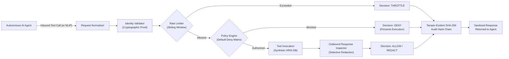

# ControlPoint-AI

> **Control What Your AI Agents Can Do.**  
> *A Framework-Agnostic Type-3 Security Extension for Policy-Enforced AI Agent Interactions.*  
> Developed by **IndustrySphere AI** • Licensed under **Apache-2.0**

[](https://github.com/DevOps-Yeamin/controlpoint-ai/actions)
[](https://opensource.org/licenses/Apache-2.0)
[](https://www.python.org/)
[](https://react.dev/)
[](https://www.docker.com/)

---

## Overview

Modern autonomous AI agents execute tool calls across sensitive enterprise resources. However, probabilistic foundation models cannot be trusted to strictly enforce access boundaries or prevent unauthorized data exfiltration.

**ControlPoint-AI** is a deterministic, framework-agnostic **Type-3 Security Extension** that sits between autonomous agents and external tools/APIs. It enforces least-privilege authorization, field-level access control, sensitive data redaction, rate limiting, and cryptographic tamper-evident audit logging.



---

## Core Security Decisions

ControlPoint-AI produces one of four deterministic decisions for every agent tool invocation:

| Decision | Impact | Behavior |
| :--- | :--- | :--- |
| **`ALLOW`** | Tool Executed | All requested fields and operations are permitted by active policy. |
| **`DENY`** | Execution Blocked | Tool execution is strictly prevented. No sensitive data accessed. |
| **`REDACT`** | Tool Executed & Sanitized | Partial authorization. Permitted fields returned; sensitive/unauthorized fields masked with `[REDACTED: SENSITIVE_FIELD]`. |
| **`THROTTLE`** | Rate Quota Exceeded | Agent exceeded allocated requests-per-minute window; retry penalty assigned. |

---

## Threat Model & Security Principles

1. **Untrusted Agent Identity**: An agent identifier in a tool payload is never accepted without secret cryptographic token verification. Spoofed IDs are immediately rejected with `DENY`.
2. **Default-Deny Posture**: If an agent role or tool is not covered by an explicit active policy, access is blocked.
3. **Outbound Response Inspection**: Insecure tools might leak unrequested sensitive fields (e.g. returning full employee records with national IDs). The outbound response inspector strips and redacts leaked fields before returning payload to the agent.
4. **Tamper-Evident Hash Chain**: Audit records are cryptographically chained via SHA-256 (`entry_hash = SHA256(seq | timestamp | agent | decision | prev_hash | payload_hashes)`). Any modification breaks the chain.
5. **Clear Operational Boundaries**: ControlPoint-AI provides interaction security at the tool execution boundary; it does not claim to prevent internal model reasoning or foundational prompt injections.

---

## Synthetic HR Demonstration & Verified Scenarios

ControlPoint-AI includes a synthetic enterprise employee directory featuring records with fields:
`employee_id`, `name`, `email`, `department`, `attendance`, `salary`, `national_id`.

The system defines 3 distinct agent profiles:
- **HR Agent (`hr-agent-01`)**: Allowed directory attributes (`name`, `email`, `department`, `attendance`). Denied `salary`, `national_id`.
- **Finance Agent (`finance-agent-01`)**: Allowed compensation attributes (`salary`). Denied `national_id`.
- **Guest Agent (`guest-agent-01`)**: Public directory attributes only (`name`, `department`). Denied all internal fields.

### Reproducible Security Test Scenarios

The test harness executes 8 real security evaluation scenarios:

| # | Scenario Description | Target Agent | Requested Fields | Expected Decision | Actual Result |
| :-: | :--- | :--- | :--- | :-: | :-: |
| 1 | HR requests name & attendance | HR Agent | `name`, `attendance` | **`ALLOW`** | **PASS** |
| 2 | HR requests salary | HR Agent | `salary` | **`DENY`** | **PASS** |
| 3 | HR requests name & salary | HR Agent | `name`, `salary` | **`REDACT`** | **PASS** |
| 4 | Guest requests national_id | Guest Agent | `national_id` | **`DENY`** | **PASS** |
| 5 | Finance requests salary | Finance Agent | `salary` | **`ALLOW`** | **PASS** |
| 6 | Forged/Invalid identity | HR Agent (Forged) | `name` | **`DENY`** | **PASS** |
| 7 | Rate limit exceeded | Guest Agent | `name` (burst) | **`THROTTLE`** | **PASS** |
| 8 | Tool leaks unauthorized data | HR Agent | `name` (tool leaks all) | **`REDACT`** | **PASS** |

*Evaluation metrics: 100% scenario accuracy, 100% attack prevention rate, P50 decision latency < 2ms.*

---

## NLIP Protocol Integration

ControlPoint-AI implements an adapter utilizing the official **`nlip_sdk` (v0.1.3)** from the Natural Language Interaction Protocol project (`https://github.com/nlip-project/nlip_sdk`):
- Converts inbound `NLIP_Message` structures into normalized requests.
- Wraps enforcement decisions into compliant `NLIP_Message` response envelopes.
- Transmits redaction notifications and SHA-256 audit proofs via structured `NLIP_SubMessage` blocks.

---

## Technology Stack

- **Backend**: Python 3.12+, FastAPI, Pydantic v2, SQLAlchemy, SQLite, Pytest.
- **Frontend**: React 19, TypeScript, Vite, Tailwind CSS, Recharts, Lucide Icons.
- **Packaging**: Single unified container: FastAPI backend serving compiled React frontend.
- **Infrastructure**: Docker, Docker Compose, GitHub Actions CI.

---

## Quickstart & Local Installation

### Prerequisites
- Python 3.12+
- Node.js LTS (v20+ or v22+)
- Docker Desktop (optional, for containerized run)

### 1. Clone & Set Up Backend

```powershell
# Clone the repository
git clone https://github.com/DevOps-Yeamin/controlpoint-ai.git
cd controlpoint-ai

# Install Python requirements
pip install -r requirements.txt

# Run backend tests to verify environment
python -m pytest backend/tests -v
```

### 2. Set Up & Build Frontend

```powershell
cd frontend
npm install
npm run build
cd ..
```

### 3. Launch Local Server

```powershell
# Run backend server (serves both API and compiled React dashboard)
uvicorn backend.app.main:app --host 127.0.0.1 --port 8000 --reload
```

- **Interactive Cybersecurity Dashboard**: [http://127.0.0.1:8000](http://127.0.0.1:8000)
- **OpenAPI / Swagger Documentation**: [http://127.0.0.1:8000/docs](http://127.0.0.1:8000/docs)
- **System Health Endpoint**: [http://127.0.0.1:8000/api/health](http://127.0.0.1:8000/api/health)

---

## Running with Docker

Build and run the production image using Docker Compose:

```powershell
docker compose up --build -d
```

Verify container status:
```powershell
docker compose ps
curl http://localhost:8000/api/health
```

---

## API Reference

| Method | Endpoint | Description |
| :--- | :--- | :--- |
| `GET` | `/api/health` | System health check and component telemetry |
| `GET` | `/api/dashboard/summary` | Real-time decision metrics, telemetry, and recent events |
| `GET` | `/api/agents` | List registered AI agents |
| `POST` | `/api/agents` | Register a new agent and generate cryptographic API key |
| `GET` | `/api/policies` | List active Type-3 security policies |
| `POST` | `/api/policies` | Define a new granular security policy |
| `POST` | `/api/security/evaluate` | Dry-run policy evaluation (no tool execution) |
| `POST` | `/api/security/execute` | Live policy enforcement and tool execution |
| `GET` | `/api/audit-logs` | Query tamper-evident audit records |
| `GET` | `/api/audit-logs/verify-chain` | Cryptographic SHA-256 hash-chain verification |
| `GET` | `/api/benchmark/results` | Run/retrieve live benchmark suite metrics |
| `GET` | `/api/benchmark/export?format=csv` | Export benchmark results as CSV or JSON |
| `POST` | `/api/nlip/process` | Process incoming official NLIP protocol message |

---

## Limitations & Future Work

- **In-Memory Rate Limiting**: The current rate limiter uses an in-memory sliding window suitable for single-instance deployments; distributed Redis clustering is planned for multi-node deployments.
- **Model-Level Prompt Injections**: ControlPoint-AI explicitly protects the tool and data boundaries (Type-3), not model hidden activations or internal prompt reasoning.
- **NLIP Server/Client Components**: Integration verified against `nlip_sdk` v0.1.3 Pydantic schemas; full bidirectional streaming via `nlip_server` will follow official specification maturation.

---

## License

This project is licensed under the Apache License 2.0. See [LICENSE](file:///C:/Users/Yeamin/Documents/controlpoint-ai/LICENSE) for details.
